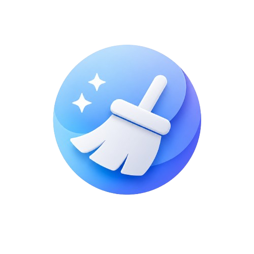
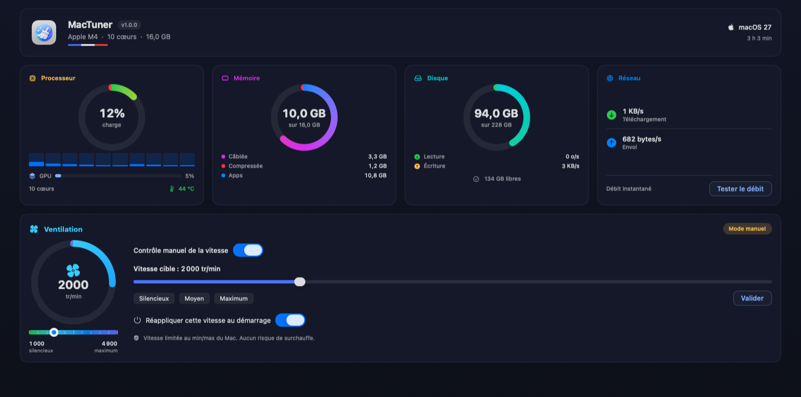

<div align="center">



# MacTuner

**Le centre de contrôle, de réglage et d'entretien de votre Mac Apple Silicon.**
*The all-in-one control, tuning and maintenance center for your Apple Silicon Mac.*


**🇫🇷 Français · 🇬🇧 English** — *Libre et open source · Free and open source*

<br/>



</div>

---

## 🇫🇷 Présentation

MacTuner rassemble en une seule application native (SwiftUI) tout ce qu'il faut pour maîtriser son Mac : **surveiller** le matériel en temps réel (CPU, GPU, mémoire, réseau, ventilation), **désactiver** les fonctionnalités système superflues, **nettoyer** caches utilisateur et système, **libérer de l'espace** (gros fichiers, doublons, installeurs), **désinstaller** sans résidu, **entretenir** le système, **ajuster** le Finder et le Dock, et **piloter la ventilation**.

Un principe constant : *rien n'est fait dans votre dos, tout est réversible, et un garde-fou central rend impossible la suppression de fichiers critiques.* MacTuner n'utilise que des mécanismes documentés d'Apple (`launchctl`, `defaults`, IOKit SMC) — aucun fichier système n'est jamais modifié.

## 🇬🇧 Overview

MacTuner brings together, in a single native SwiftUI app, everything needed to master your Mac: **monitor** the hardware live (CPU, GPU, memory, network, cooling), **disable** unneeded system features, **clean** user and system caches, **free up space** (large files, duplicates, installers), **uninstall** with zero leftovers, **maintain** the system, **tweak** the Finder and Dock, and **control the fan**. Nothing happens behind your back, everything is reversible, and a central guard makes deleting critical files impossible.

## Fonctionnalités · Features

| | |
|---|---|
| 📊 **Tableau de bord** | CPU (global + par cœur), **GPU en temps réel**, mémoire, disque, réseau, température, **batterie** (portables), ventilation — temps réel, sans mot de passe. |
| 🌀 **Ventilation** | Contrôle manuel borné au min/max constructeur (zéro surchauffe), presets, et **réglage réellement persistant** : réappliqué au lancement, au réveil et au démarrage du Mac. Un seul mot de passe grâce à l'autorisation persistante. |
| ⚙️ **Fonctionnalités** | 34 réglages système désactivables/réactivables (Siri, Apple Intelligence, télémétrie, iCloud…), par catégorie ou par sous-processus. 100 % réversible. |
| 🧹 **Nettoyage** | 30+ catégories de fichiers régénérables — caches utilisateur **et système** (droits admin), builds Xcode et Xcode Beta, navigateurs, messageries Electron, conteneurs orphelins, **artefacts de projets** (node_modules, .build, Pods…), **installeurs oubliés** et **résidus d'apps disparues** — plus le nettoyage des **langues** inutilisées et le **journal** des suppressions, regroupés sous un même onglet. |
| 💽 **Espace** | **Fichiers volumineux**, **doublons**, vieux installeurs et **répartition** du disque par dossier. Envoi à la Corbeille, récupérable. |
| 🎚️ **Tweaks** | Interrupteurs pour le Finder (fichiers cachés, extensions, barre de chemin…), le Dock, les captures d'écran et l'**anti-veille** (persistant). |
| 🗑️ **Désinstaller** | Résidus traqués jusque dans `~/`, `~/Library`, `/Library` et les commandes `/usr/local/bin` liées au bundle (les 8 `prl*` de Parallels, ses 63 Go de VM…). Apps — y compris **Xcode et Xcode Beta** et leurs dizaines de Go sous `~/Library/Developer` —, outils CLI (alias regroupés, données résolues via symlinks) et fichiers cachés `~/.xxx`, sans aucune trace. Tri par taille, icône par type de résidu. |
| 🔧 **Maintenance** | Cache DNS, mémoire, réindex Spotlight, snapshots Time Machine, cache d'icônes, Launch Services, Dock/Finder, **compactage SQLite**, historique Gatekeeper, caches de polices, **simulateurs iOS indisponibles**. |
| ℹ️ **Système** | Caractéristiques (puce, **GPU**, mémoire, batterie, **résolution**), accès rapide aux volets de Réglages et aux utilitaires macOS, gestion des **agents de démarrage**. |
| ⚙️ **Réglages** *(icône ronde)* | Langue, compatibilité, autorisations persistantes, **nettoyage hebdomadaire planifié**, réinitialisation, désinstallation de MacTuner. |

## SIP · System Integrity Protection

Sur macOS 26/27, **SIP** (activé par défaut) refuse d'arrêter les agents Apple : `launchctl bootout` renvoie l'erreur 150. MacTuner ne le cache pas — l'onglet **Fonctionnalités** classe chaque réglage en **deux catégories claires** :

- ✅ **Effet immédiat (compatibles SIP)** — réglages de préférences (`defaults`) et commandes système (Spotlight, Power Nap, son de démarrage…). Ils s'appliquent tout de suite, que SIP soit activé ou non.
- ⚠️ **Nécessite SIP désactivé** — réglages qui reposent sur l'**arrêt d'un agent Apple** (Siri, Apple Intelligence, télémétrie, iCloud…). Avec SIP activé, ces réglages sont **grisés et non modifiables** dans l'app (leur effet n'arriverait qu'après `csrutil disable` depuis la Recovery). Ils redeviennent actifs automatiquement une fois SIP désactivé.

MacTuner détecte l'état réel : un réglage qui repose sur un agent Apple bloqué par SIP est signalé comme tel, jamais présenté comme appliqué. Quand SIP est désactivé, un LaunchAgent utilisateur ré-applique vos choix à chaque ouverture de session, car macOS 26/27 réactive de lui-même certains agents au démarrage.

*🇬🇧 On macOS 26/27, SIP refuses to stop Apple agents (`bootout` fails with error 150). The **Features** tab splits every setting into two categories: **Immediate effect (SIP-compatible)** — preference and system commands that apply right away — and **Requires SIP disabled** — settings that rely on stopping an Apple agent, which only take effect after `csrutil disable` from Recovery. MacTuner detects the real state and never presents a SIP-blocked setting as applied.*

## Sécurité

Toute suppression passe par une **liste blanche stricte** (`SafetyGuard`) : `/System`, `/usr`, **apps protégées par SIP** (Safari et apps intégrées), Documents/Photos/Bureau, trousseaux, iCloud Drive, Mail, Messages, clés SSH et fichiers shell sont refusés d'office. Les apps Apple simplement *téléchargées* (Xcode, Xcode Beta…) ne portent pas ce drapeau de protection et sont, elles, désinstallables comme n'importe quelle app. Les droits administrateur se limitent à des commandes précises via des règles `sudoers` **révocables**. Seuls des mécanismes documentés d'Apple sont utilisés (`launchctl`, `defaults`, IOKit SMC) — aucun fichier système n'est jamais modifié.

## Langues · Languages

Interface entièrement **française et anglaise**, choix au premier lancement et dans les Réglages, changement à chaud. Aucune chaîne en dur : tout passe par `L10n.t("clé")` (`Sources/Strings.swift`).

## Installation

**MacTuner se compile depuis les sources.** Il n'y a pas d'archive à télécharger : le
code est ici, vous produisez vous-même le binaire que vous exécutez. C'est le seul
moyen d'être certain que l'app fait exactement ce que le code dit.

Prérequis : **macOS 26 ou 27**, Mac **Apple Silicon** (M1 à M4), et les *Command
Line Tools* d'Apple. Aucune dépendance externe, pas de Xcode requis.

```bash
xcode-select --install          # une seule fois, si ce n'est pas déjà fait
git clone https://github.com/Bodyroro/MacTuner.git
cd MacTuner
./build.sh
```

`build.sh` compile toutes les sources avec l'en-tête C `smc_bridge.h` (disposition mémoire exacte pour le SMC), cible **macOS 26.0** (garantit la compatibilité 26 **et** 27), génère l'icône, signe le bundle en ad-hoc et lance l'app.

L'app se lance à la fin de la compilation. Pour l'installer durablement, glissez
**MacTuner.app** dans votre dossier **Applications**.

> Le bundle est signé en **ad-hoc**, pas notarisé : il est valide sur votre
> machine puisque vous venez de le produire. Aucune manipulation de Gatekeeper
> n'est nécessaire — celle-ci ne concernait que les archives téléchargées.

Compilation manuelle équivalente, si vous préférez voir chaque étape :

```bash
swiftc -O -parse-as-library -target arm64-apple-macos26.0 \
  -import-objc-header smc_bridge.h \
  Sources/**/*.swift Sources/*.swift \
  -o MacTuner.app/Contents/MacOS/MacTuner
codesign --force --sign - MacTuner.app
open MacTuner.app
```

*English — MacTuner is built from source; there is no download. Install Apple's
Command Line Tools, clone the repository, run `./build.sh`, then move
**MacTuner.app** to **Applications**. Requires macOS 26 or 27 on Apple Silicon.*

## Architecture

```
mactuner/
├── build.sh                  Compilation + signature + lancement
├── smc_bridge.h              En-tête C pour l'accès SMC (IOKit)
├── logo.png                  Icône source
├── dashboard.png             Capture du tableau de bord (README)
├── Sources/
│   ├── Localization.swift    Moteur L10n + enum Lang
│   ├── Strings.swift         Table de traduction FR / EN
│   ├── Core/                 Shell, LaunchCtl, SafetyGuard, SysInfo, SysCompat, Helpers
│   ├── Sensors/              SMC, statistiques système (CPU/GPU/mém/réseau), batterie
│   ├── Features/             Fonctionnalités, nettoyage utilisateur + système, espace disque,
│   │                         tweaks, désinstallation, maintenance, agents de démarrage,
│   │                         ventilateur, autorisations, planification, modèles
│   ├── UI/                   Composants réutilisables (cartes, jauges, sélecteurs)
│   ├── Views/                Une vue SwiftUI par onglet
│   └── App/                  Point d'entrée, TabView racine
```

## Licence

**MIT** — totalement libre à l'utilisation, à la modification et à la redistribution, sources comprises. Voir [`LICENSE`](LICENSE).

## Avertissement

MacTuner modifie des réglages système. Toutes les actions sont réversibles et protégées par des garde-fous, mais utilisez-le en connaissance de cause. Fourni sans garantie.

---

<div align="center">

Créé par **Rodolphe Vandaele** · [bodyroro.github.io](https://bodyroro.github.io) · [github.com/Bodyroro/MacTuner](https://github.com/Bodyroro/MacTuner)

*Conçu pour macOS 26–27 · Apple Silicon*

</div>
